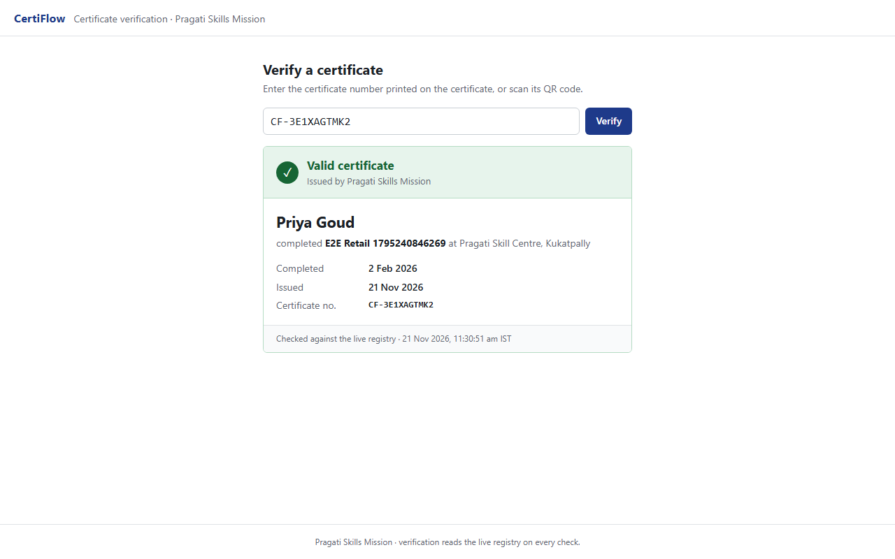
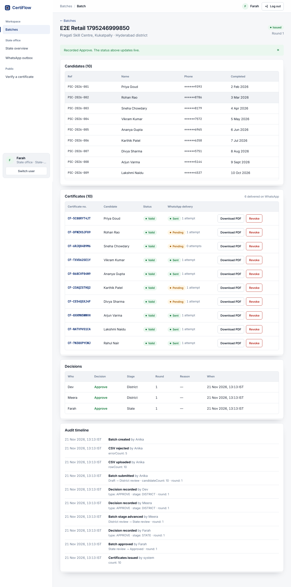
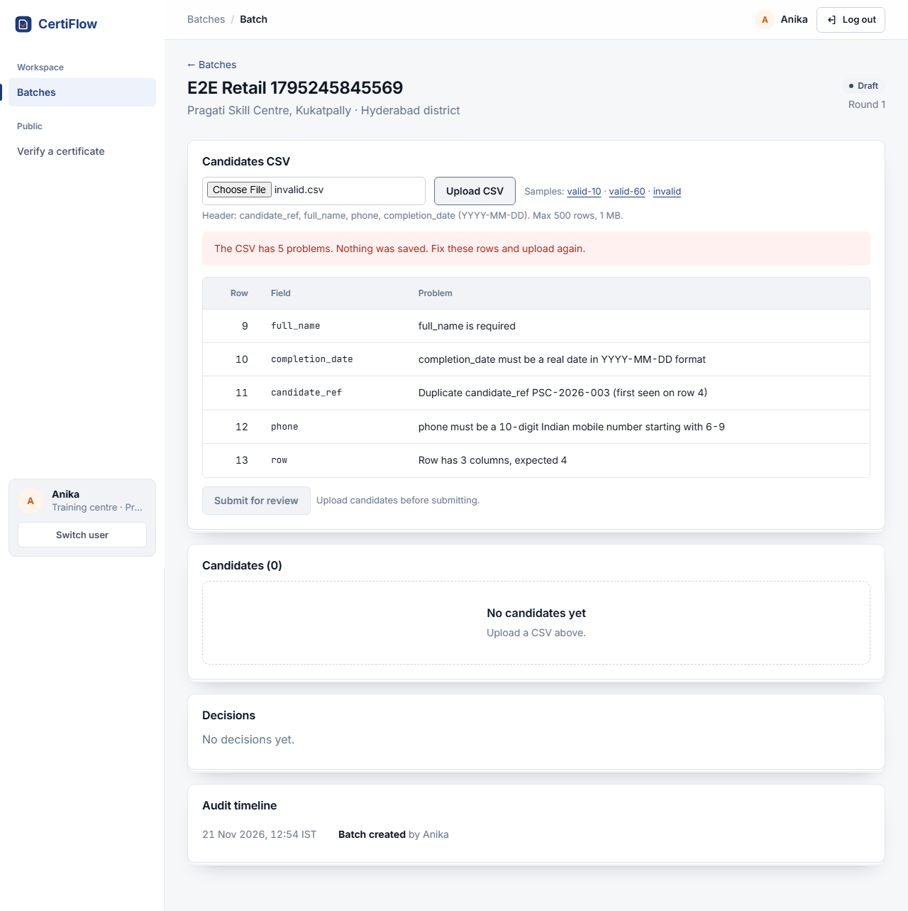

# CertiFlow

Skilling certificate issuance for a state skills mission. A training centre uploads its candidates, district, quality
and state reviewers approve the batch, the system issues certificates and sends each candidate a WhatsApp message.
Anyone, such as an employer, can verify a certificate from its QR code. Revocation takes effect on the next check.



**Run it:** `docker compose up --build -d`, then open http://localhost:8080. See [SETUP.md](SETUP.md).
Deployment plan: [DEPLOYMENT.md](DEPLOYMENT.md). Self-review: [docs/SELF_REVIEW.md](docs/SELF_REVIEW.md).

---

## 1. Requirements note

How the brief was interpreted. Where the brief left a choice open, the choice and its reason are stated.

- **Roles and scope.** Four roles. `CENTRE` sees only its own centre's batches. `DISTRICT_OFFICER` sees its district.
  `QUALITY` sees batches currently in quality review plus any it decided on. `STATE` sees everything. A batch you may
  not see returns **404, not 403**, so its existence isn't leaked. One function (`scope.ts › batchScope`) defines this
  for every list, detail, action and live event.
- **Approval chain.** `DRAFT → DISTRICT_REVIEW → [QUALITY_REVIEW] → STATE_REVIEW → APPROVED → ISSUED`. District review
  needs **2 different officers**. Quality review applies only when the batch has **≥ `QUALITY_THRESHOLD` (default 50)**
  candidates. Any review stage can **return** a batch to the centre (to fix and resubmit) or **reject** it (final).
  A reason of at least 5 characters is required for both.
- **Rounds.** Approvals belong to a round. Resubmitting a returned batch starts round N+1, and earlier approvals no
  longer count, because the data may have changed. Old decisions stay in the audit trail.
- **CSV is the source of truth.** An upload replaces all candidates atomically. Every row is validated and every
  error is reported (spreadsheet row numbers, header = row 1). If any row is invalid, nothing is saved.
- **Issuance never waits on WhatsApp.** A batch becomes `ISSUED` and its certificates verify as `VALID` even if every
  message fails. Delivery is retried separately and can be re-queued after an outage.
- **Revocation never deletes.** The certificate keeps who revoked it, when and why. Verification shows `REVOKED` on the
  very next request (no cache), the PDF returns 410, and an unsent delivery is cancelled.
- **SLA.** A batch waiting more than `SLA_MINUTES` (default 2, a demo value) in a review stage is escalated once per
  stage visit, and shown to the state office.
- **Audit.** Every change writes an audit row in the same transaction. A database trigger makes the audit table
  append-only.
- **Demo sign-in.** You pick a seeded user; there are no passwords. Every permission is still enforced by the server.
  Identity comes only from the signed token, and the user is re-read from the database on every request.

## 2. Architecture

```
browser ──► nginx :8080 ──► api (Express, :4000, not published) ──► PostgreSQL 16
   ▲          (SPA + /api proxy, SSE)        │  ▲                       ▲
   └──── SSE /api/events ◄── Redis pub/sub ◄─┘  └── BullMQ (Redis 7) ──► worker
```

- **`apps/api`**: Express + TypeScript + Prisma. One image, two entrypoints: `src/server.ts` (HTTP) and
  `src/worker.ts` (BullMQ queues `certificates`, `delivery`, `maintenance`). Job logic lives in plain functions
  (`src/jobs/*`) that the tests call directly.
- **`apps/web`**: React + Vite, plain CSS, served by nginx. nginx proxies `/api` (SSE unbuffered on `/api/events`).
- **Live updates**: domain events are published to Redis `certiflow:events` after each commit. Every API instance
  subscribes and forwards them to its SSE clients, filtered by the same scope rules. This works with several API
  instances and with events raised by the worker.
- **Reliability**: issuance and delivery are idempotent. A reconciler (every 30s) re-enqueues APPROVED batches and
  PENDING deliveries that have gone stale. Redis runs with AOF persistence.

## 3. Key technical decisions

| Decision | Why |
|---|---|
| **PostgreSQL as the source of truth** | Correctness lives in the DB: unique constraints (one decision per officer per stage per round, one certificate per candidate, unique certificate number, one delivery per certificate), row locks for concurrent decisions, and transactions for atomic CSV import. Redis can be wiped and the reconciler rebuilds pending work from Postgres. |
| **Row lock + unique constraint for approvals** | `SELECT … FOR UPDATE` on the batch serialises concurrent decisions, so the stage transition happens once. The unique `(batchId, stage, round, actorId)` constraint is a second, independent guarantee that one officer can never count twice, even if the application code has a bug. |
| **Redis + BullMQ for background work (the queue choice)** | Approval must not wait for 60 certificates and 60 WhatsApp messages. BullMQ gives durable jobs, retries with exponential backoff (issuance 5 attempts, delivery 6, starting at 2s), stalled-job recovery after worker crashes, and repeatable jobs (reconciler and SLA, every 30s). We already need Redis for pub/sub and rate limiting, so it adds no new infrastructure. SQS or Kafka would add a system without adding anything we need at this volume (see DEPLOYMENT.md §8). |
| **Idempotent processors over "exactly-once" queues** | Queues deliver at least once. Every processor is safe to run twice: issuance locks the batch, returns if it is already ISSUED, and only creates missing certificates; delivery returns if SENT; the provider dedupes on `idempotencyKey = delivery id`, so a retry after "accepted but timed out" never sends twice. |
| **Reconciler job** | Covers the gap between "DB committed" and "job enqueued" (a crash in between, or lost Redis data). Every 30s it re-enqueues APPROVED batches older than 30s and PENDING deliveries not updated for 2 minutes. |
| **Simulated WhatsApp provider** | No real account is available. The stand-in fails 25% of the time and is sometimes "accepted but slow" (10%: it records the message, then answers after our 3s timeout, the most dangerous real-world case for duplicates). Modes: `flaky` (default), `healthy`, `down` via `WHATSAPP_MODE`. A real provider would implement the same `WhatsAppProvider.send()` interface. |
| **SSE (not WebSockets)** | Updates only flow server to browser. SSE is plain HTTP, reconnects automatically, and passes through nginx (buffering off on `/api/events`). Redis pub/sub fans events out across API instances and from the worker. |
| **PDF rendered on demand** | A revoked certificate can never be served (410), and there are no stale files. The trade-off is CPU per download (each PDF is ~140 KB, on a 128 KB JPEG background). DEPLOYMENT.md plans pre-rendered files in S3 at scale. |
| **Append-only audit enforced by a DB trigger** | Audit rows are written in the *same transaction* as the change, so they can't disagree with it, and UPDATE/DELETE are rejected by Postgres itself. |
| **One API image, two entrypoints (api, worker)** | One codebase and shared domain logic (`batchWorkflow.ts` is the only place batch status changes), scaled independently. No microservices. |
| **Scope in one function, 404 for out-of-scope** | `scope.ts › batchScope` decides visibility for lists, details, actions and live events alike, so the rules can't drift apart, and other districts' batches stay invisible. |

## 4. Screens

| Batch list, live ("Waiting for me") | Batch detail with certificates |
|---|---|
|  |  |
| **Row-level CSV errors** | **State overview** |
|  |  |

Screens: demo login, batches (tabs, live), batch detail (CSV upload, review actions, candidates, decisions,
certificates, audit timeline), state overview, simulated WhatsApp outbox, and public `/verify/:certNo`.

## 5. Key rules and how they are enforced

| Rule | Enforcement |
|---|---|
| One officer counts once per stage and round | Unique `(batchId, stage, round, actorId)` + `SELECT … FOR UPDATE` on the batch row |
| A batch advances exactly once under concurrent approvals | Row lock serialises decisions; the count happens under the lock |
| Exactly one certificate per candidate | Unique `candidateId` (and `(batchId, candidateId)`); issuance under a batch row lock |
| A WhatsApp retry never sends twice | Provider idempotency key = delivery id (`OutboundMessage.idempotencyKey` unique) |
| Status changes only through the state machine | `batchWorkflow.ts › TRANSITIONS` + `moveTo()`; nothing else writes `Batch.status` |
| Audit cannot be edited | Postgres trigger raises on `UPDATE`/`DELETE` of `"AuditLog"` |
| Public verification can't be enumerated | 50-bit random certificate numbers + Redis rate limit (60/min/IP) |
| Staff don't see candidates' full phone numbers | API masks phones (`******1234`) for every role except the owning centre |

## 6. API overview

All routes are under `/api`. "Scoped" means a batch outside your scope is 404.

| Method | Path | Who | What |
|---|---|---|---|
| GET | `/health`, `/health/ready` | public | Liveness; readiness checks Postgres and Redis (503 if either is down) |
| GET | `/auth/demo-users` | public | Seeded users (name, role, district/centre; no emails) |
| POST | `/auth/demo-login` | public | `{ userId }` → `{ token, user }` (HS256 JWT, 8h) |
| GET | `/me` | any signed-in user | Current user, re-read from the DB |
| GET | `/events?token=` | any signed-in user | Server-Sent Events, filtered by scope; heartbeat every 20s |
| POST | `/batches` | CENTRE | Create a DRAFT batch for the user's own centre |
| GET | `/batches?status=&escalated=true` | any signed-in user, scoped | List with candidate count, approvals this round, `decidedByMe`. `escalated` is STATE only |
| GET | `/batches/:id` | any signed-in user, scoped | Candidates (phones masked except for the owning centre), decisions, audit timeline |
| POST | `/batches/:id/candidates/csv` | CENTRE (own, DRAFT/RETURNED) | Multipart `file`, ≤1 MB, ≤500 rows. 422 `CSV_INVALID` with every row error |
| POST | `/batches/:id/submit` | CENTRE (own, DRAFT/RETURNED) | To district review; from RETURNED starts a new round |
| POST | `/batches/:id/decisions` | DISTRICT_OFFICER (same district) / QUALITY / STATE, by stage | `{ type: APPROVE\|RETURN\|REJECT, reason? }`. 409 `ALREADY_DECIDED` / `INVALID_STATE` |
| GET | `/batches/:id/certificates` | any signed-in user, scoped | Certificates with delivery status and attempts |
| GET | `/certificates/:certNo` | any signed-in user, scoped | One certificate with its delivery and audit timeline |
| GET | `/certificates/:certNo/pdf` | `?token=` (candidate link) or STATE / owning CENTRE | PDF rendered on demand; 410 if revoked; otherwise 403 |
| POST | `/certificates/:certNo/revoke` | STATE | `{ reason }`; 409 if already revoked; cancels an unsent delivery |
| POST | `/deliveries/retry-failed` | STATE | Re-queue FAILED deliveries after an outage |
| GET | `/public/verify/:certNo` | public, 60/min/IP | `{ status, certificateNo, candidateName, courseName, centreName, completionDate, issuedAt, revokedAt? }`; 404 `{ status: "INVALID" }`; 400 bad format; `Cache-Control: no-store` |
| GET | `/public/stats` | public, 60/min/IP | Aggregate counts for the landing page: certificates issued and currently valid |
| GET | `/stats` | STATE | Real counts: batches by status, certificates, deliveries by status, escalated |
| GET | `/dev/outbox` | STATE | Simulated WhatsApp outbox (phones masked) |
| GET | `/audit?entityType=&entityId=` | STATE | Audit rows (newest first) |

Errors are always `{ error: { code, message, details? } }`. A 500 never includes a stack trace.

## 7. Tests

`docker compose run --rm api npm test` runs **46 API tests in 7 files** against a real Postgres test database
(migrated and seeded by the global setup) and Redis. `npm run e2e -w apps/web` runs **7 Playwright browser tests**
against the running stack (not in CI; it needs every service). CI runs the API tests, a curl walkthrough
(`scripts/walkthrough.sh`, DRAFT → ISSUED → VALID → REVOKED), the web build, and `docker compose build`.

| Moment | Tests |
|---|---|
| **CSV upload** | invalid CSV reports row-level errors and saves nothing · duplicate candidate_ref is reported with both row numbers · valid CSV re-upload replaces candidates atomically · oversize 413 / non-CSV 422 / missing file 400 · e2e: rows 9–13 shown in the error table |
| **Concurrency** | the same officer cannot approve twice · concurrent approvals advance the batch exactly once (4 parallel requests, 5 iterations) · re-running issuance (sequentially and 3× concurrently) never duplicates certificates or deliveries · a stuck batch is escalated exactly once (3 runs, 2 concurrent) |
| **Issuance / WhatsApp** | a 60-candidate batch gets exactly 60 certificates with unique numbers · delivery retries after failures and timeouts and sends exactly one message · a timeout after the provider accepted does not send twice · a WhatsApp outage does not block issuance (+ retry-failed re-queues) · e2e: 60-candidate batch through quality review issues 60 certificates |
| **Revocation** | revoked certificates fail verification immediately (and the PDF is 410, a second revoke is 409, non-state is 403, the row is kept, audited) · delivery is cancelled for a revoked certificate · e2e: verify shows REVOKED after the revoke |
| **SLA** | a stuck batch is escalated exactly once (and cleared when it moves on) · a batch inside its SLA is not escalated |
| **Resubmission** | return and resubmit starts a new round; old approvals do not count · reject and return require a reason · e2e: the centre sees the return reason, round 2 at 0/2; reject leaves no actions |
| **Must never happen** | audit log rejects UPDATE and DELETE · no/tampered/expired token → 401 · centre approving / quality at district stage → 403 · another district's officer and another centre → 404 · public verify exposes only the allowed fields · demo-users exposes no emails · staff get masked phones · outbox masks phones · malformed JSON is 400, never 500 · SSE streams only visible events · stats/outbox are STATE only · PDF: wrong token 403, another centre 403 |
| **Other** | health and readiness · full path DRAFT → APPROVED audit trail · batch of 60 goes to QUALITY_REVIEW · submitting with no candidates is refused · public verify is rate limited · e2e: live list update over SSE, PDF download is `application/pdf`, sample CSV link downloads |

## 8. Out of scope / known limitations

- **Demo authentication.** You pick a seeded user; there are no passwords or SSO. All authorization is still enforced
  server-side.
- **Simulated WhatsApp.** A provider class records messages in `OutboundMessage` (see `/whatsapp` as state). It can be
  `flaky` (25% failure, 10% "accepted but slow"), `healthy` or `down`. No real WhatsApp Business API integration.
- **PDFs are rendered on demand** from database data on every download. Nothing is stored; object storage is in
  DEPLOYMENT.md.
- **No verification cache yet.** Every check reads Postgres, which is what makes revocation immediate. A cache would need
  invalidation on revoke.
- **The rate limiter fails open** if Redis is down (a deliberate availability choice, logged as a warning).
- **A revoke during an in-flight WhatsApp send** may still deliver that one message. The delivery is marked CANCELLED
  and verification shows REVOKED.
- **Limited test coverage of the plumbing:** `reconcile()` has no test, and BullMQ retry/backoff and the "out of
  retries → FAILED" event are exercised only by calling the functions directly (see docs/SELF_REVIEW.md #13).
- **Dev-only default secrets** (`JWT_SECRET`, `DOWNLOAD_TOKEN_SECRET`) let it run with no `.env`; the API and worker
  log a warning while they are in use.
- **No deployment.** It runs locally with Docker Compose; DEPLOYMENT.md is a plan, not something that exists.
- Not built: candidate self-service, bulk revocation, notifications other than WhatsApp, multi-language certificates.

## 9. AI usage

- **Tools:** Claude (planning, architecture review, writing the prompts, reviewing output, drafting docs) and Claude
  Code (writing the code, running builds and tests, debugging).
- **How the output was checked:**
  - every phase had written acceptance criteria
  - tests run against real Postgres and Redis in CI (GitHub Actions)
  - a separate run of the migrations, the full test suite and an end-to-end API walkthrough (upload to approvals,
    issuance, delivery, verify, revoke), run on a fresh clone in Docker; earlier commits also re-run 3× to check for
    flakiness
  - critical modules (`batchWorkflow.ts`, issuance, delivery) were read and reviewed by hand
  - a Playwright run in a real browser, with screenshots reviewed by eye
- **Example of a correction:** an AI-written concurrency test asserted the wrong thing (it assumed a specific officer
  would win the lock). We changed it to assert the real invariant: exactly 2 decisions, and no officer with 2.
- **Problems caught by verification** (each fixed in the commit history; see also docs/SELF_REVIEW.md):
  - The SSE subscriber didn't wait for Redis `SUBSCRIBE` on the first connection, so live events could be missed. A
    test failed in Docker, and step-by-step debugging in the container found the missing `return`.
  - The API image didn't contain `samples/`, so 27 tests failed inside Docker. CI hadn't noticed because it runs the
    tests outside Docker.
  - A copied `.env.example` pointed the containers at their own `localhost` for Postgres and Redis.
  - The readiness probe hung forever when Redis was down (`maxRetriesPerRequest: null`); each check now times out
    after 2s.
  - The Postgres healthcheck could pass while the init script's temporary server was still running; it now checks
    over TCP.
  - A third officer approving after the batch had already advanced got 403; it should be 409 (INVALID_STATE).
  - A revoke landing during a WhatsApp send could be overwritten by SENT; the SENT update is now conditional.
  - The rate limiter could be bypassed with a forged `X-Forwarded-For` while the API port was published; the port is
    closed and `trust proxy` is exactly one hop (nginx).
  - Malformed JSON returned 500 (now 400). Staff saw candidates' full phone numbers (now masked by the API).
  - Screenshot review: the certificates table hid row 10 in a scroll box, a flash message went stale after the status
    changed, and links styled as buttons were underlined.
- All design decisions above were made deliberately, and the author can explain each one.
